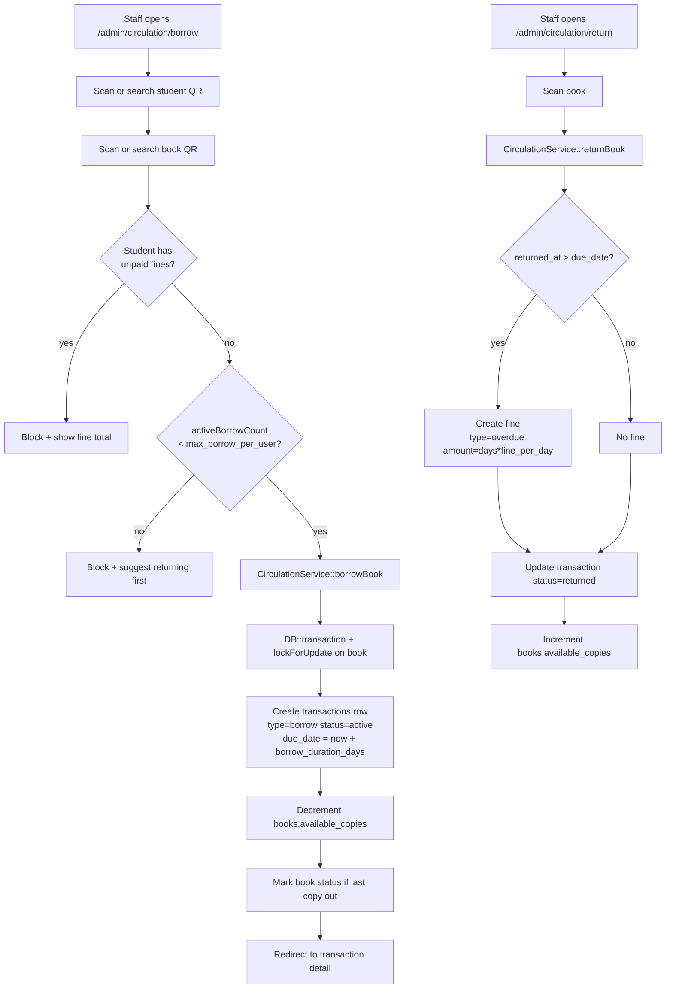
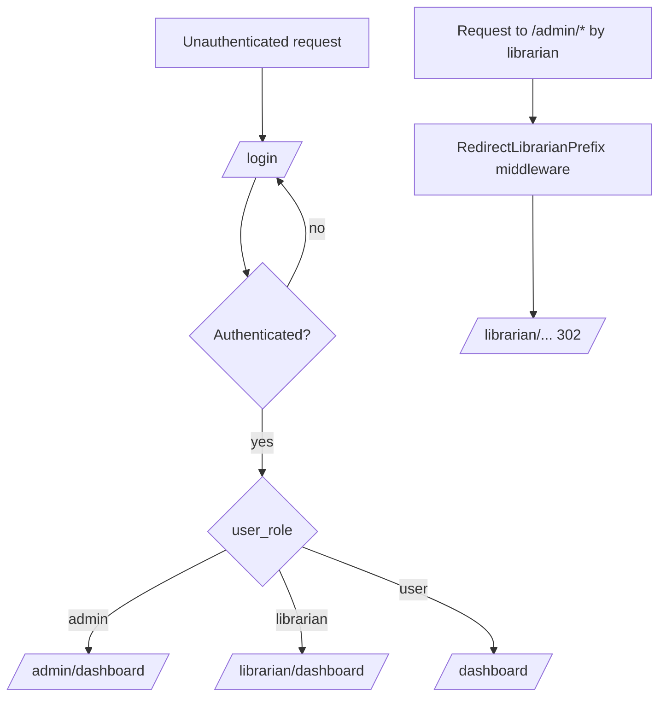
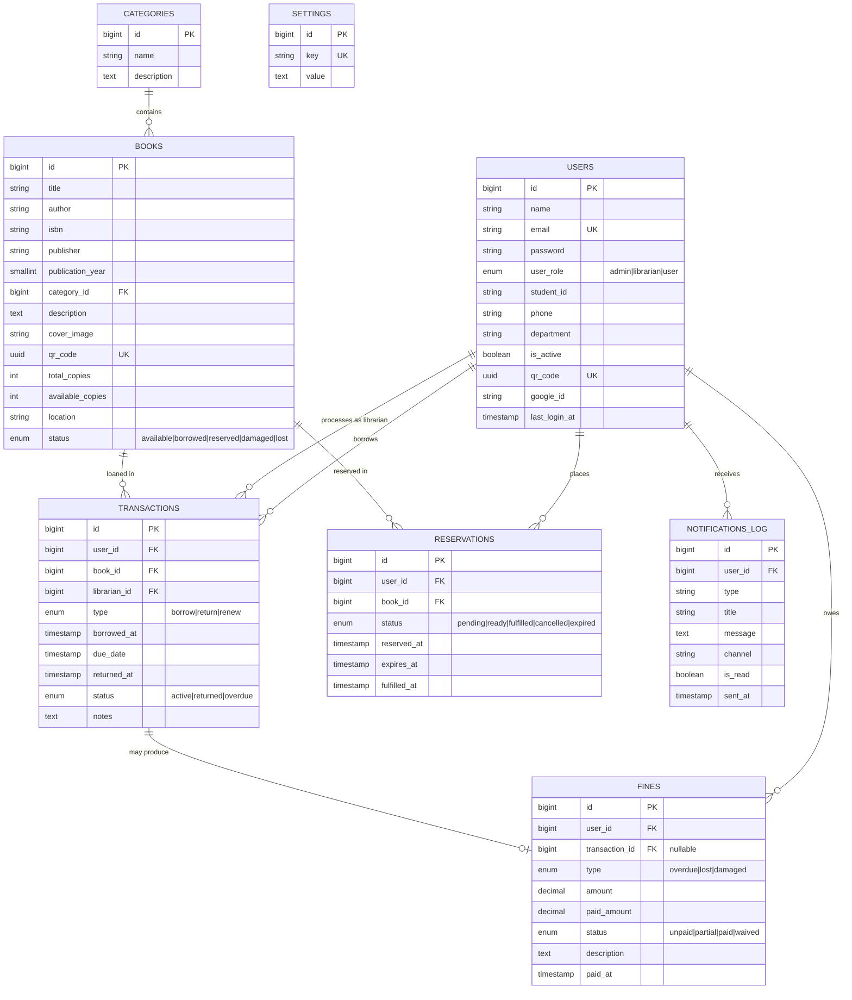

# LIBTRACK — Full Project Documentation

> **LIBTRACK** is a role-based library management system built with **Laravel 12**, **React 19 (Inertia.js)**, **TypeScript**, **Tailwind CSS 4**, and **PostgreSQL**. It handles the full library workflow — book catalog, student accounts, borrowing and returns, reservations, fine auto-calculation for overdue items, and QR-code scanning for fast check-in/check-out — with separate experiences for administrators, librarians, and students.

---

## Table of Contents

1. [Overview](#1-overview)
2. [Feature Matrix](#2-feature-matrix)
3. [Tech Stack](#3-tech-stack)
4. [Repository Structure](#4-repository-structure)
5. [Architecture](#5-architecture)
6. [Data Model](#6-data-model)
7. [Roles & Authentication](#7-roles--authentication)
8. [Routes Reference](#8-routes-reference)
9. [Key Pages (Inertia / React)](#9-key-pages-inertia--react)
10. [Services & Background Jobs](#10-services--background-jobs)
11. [QR Code System](#11-qr-code-system)
12. [Settings](#12-settings)
13. [Installation & Setup](#13-installation--setup)
14. [Development Workflow](#14-development-workflow)
15. [Testing & Linting](#15-testing--linting)
16. [Deployment Notes](#16-deployment-notes)
17. [Troubleshooting](#17-troubleshooting)
18. [Project Status](#18-project-status)
19. [Glossary](#19-glossary)

---

## 1. Overview

LIBTRACK is a full-stack web application for managing the day-to-day operations of a school or institutional library. It provides:

- **Cataloging** — adding, editing, and organizing books with categories, cover images, ISBN, publication data, and per-book QR codes.
- **Circulation** — borrowing and returning books with automatic due dates, overdue detection, and fine generation.
- **Members** — user accounts with three roles (admin, librarian, student), per-student QR cards, department/program metadata, and Google OAuth sign-in.
- **Reservations** — students can queue for unavailable books; reservations expire automatically after a configurable window.
- **Fines** — unpaid, partial, paid, or waived states; auto-computed from overdue days or manually created for lost/damaged items.
- **Reports & Inventory** — borrowing history, overdue snapshots, and stock-level views exportable to file.
- **Configuration** — admin-editable settings for borrow duration, per-user borrow limit, daily fine rate, and reservation expiry.

The project targets three audiences:

| Audience      | Entry point                  | Typical daily use                                      |
| ------------- | ---------------------------- | ------------------------------------------------------ |
| Administrator | `/admin/dashboard`           | User and catalog management, system settings, reports  |
| Librarian     | `/librarian/dashboard`       | Circulation counter, fine handling, inventory checks   |
| Student       | `/dashboard`                 | Search books, view borrowing history, view/pay fines   |

---

## 2. Feature Matrix

| Feature                              | Admin | Librarian | Student |
| ------------------------------------ | :---: | :-------: | :-----: |
| Book catalog (CRUD)                  |   •   |     •     |   —     |
| Browse/search catalog (read-only)    |   •   |     •     |   •     |
| Category management (CRUD)           |   •   |     •     |   —     |
| User management (CRUD, toggle active)|   •   |     —     |   —     |
| Borrowing (process new loan)         |   •   |     •     |   —     |
| Return (process return + fine)       |   •   |     •     |   —     |
| View own borrowing history           |   •   |     •     |   •     |
| Reservations (own)                   |   —   |     —     |   •     |
| Manage/approve reservations          |   •   |     •     |   —     |
| Fines — create, update, mark paid    |   •   |     •     |   —     |
| View own fines                       |   —   |     —     |   •     |
| Reports (borrowing / overdue / stock)|   •   |     •     |   —     |
| Inventory status + export            |   •   |     •     |   —     |
| System settings (borrow/fine rules)  |   •   |     •     |   —     |
| QR code generation                   |   •   |     •     |   —     |
| QR code scanning (via webcam)        |   •   |     •     |   —     |
| Download own QR card                 |   •   |     •     |   •     |
| Profile & password update            |   •   |     •     |   •     |
| Google OAuth sign-in                 |   •   |     •     |   •     |

---

## 3. Tech Stack

### Backend

| Layer               | Choice                                               |
| ------------------- | ---------------------------------------------------- |
| Language            | PHP 8.2+                                             |
| Framework           | Laravel 12                                           |
| Database            | PostgreSQL 12+                                       |
| ORM                 | Eloquent                                             |
| Auth                | Laravel session auth + `laravel/socialite` (Google)  |
| SSR bridge          | `inertiajs/inertia-laravel`                          |
| QR generation       | `chillerlan/php-qrcode`                              |
| Route helper (FE)   | `tightenco/ziggy`                                    |
| Dev ergonomics      | `laravel/tinker`, `laravel/pail`, `laravel/pint`     |
| Tests               | PHPUnit 11 + Pest, Mockery, Faker                    |

### Frontend

| Layer               | Choice                                               |
| ------------------- | ---------------------------------------------------- |
| Framework           | React 19 + TypeScript 5.7                            |
| Router              | Inertia.js 2.0                                       |
| Styling             | Tailwind CSS 4 (Vite plugin)                         |
| UI primitives       | shadcn/ui on top of Radix UI (Dialog, Dropdown, Tabs, Select, Toast, …) |
| Icons               | lucide-react                                         |
| Animation           | framer-motion                                        |
| Toasts              | react-hot-toast                                      |
| QR scanning         | html5-qrcode 2.3.8                                   |
| Build               | Vite 6                                               |
| Lint / format       | ESLint 9 + Prettier 3 (with `prettier-plugin-tailwindcss`) |

---

## 4. Repository Structure

```
LIBTRACK/
├── app/
│   ├── Console/Commands/
│   │   └── CheckOverdueBooks.php         # Daily job: mark overdue + auto-create fines
│   ├── Http/
│   │   ├── Controllers/
│   │   │   ├── Admin/                    # Staff-facing controllers (admin + librarian)
│   │   │   │   ├── DashboardController.php
│   │   │   │   ├── BookController.php
│   │   │   │   ├── CategoryController.php
│   │   │   │   ├── UserController.php    # Admin-only
│   │   │   │   ├── CirculationController.php
│   │   │   │   ├── FineController.php
│   │   │   │   ├── ReportController.php
│   │   │   │   ├── InventoryController.php
│   │   │   │   └── SettingsController.php
│   │   │   ├── User/                     # Student-facing controllers
│   │   │   │   ├── UserDashboardController.php
│   │   │   │   ├── BookSearchController.php
│   │   │   │   ├── BorrowingController.php
│   │   │   │   ├── FineController.php
│   │   │   │   └── UserSettingsController.php
│   │   │   ├── Auth/
│   │   │   │   ├── LoginController.php
│   │   │   │   ├── RegisterController.php
│   │   │   │   └── SocialAuthController.php
│   │   │   ├── Api/
│   │   │   │   └── QrLookupController.php
│   │   │   └── HomeController.php
│   │   ├── Middleware/
│   │   │   ├── AdminMiddleware.php
│   │   │   ├── StaffMiddleware.php
│   │   │   ├── UserMiddleware.php
│   │   │   ├── GuestMiddleware.php
│   │   │   ├── RedirectLibrarianPrefix.php
│   │   │   ├── HandleInertiaRequests.php
│   │   │   └── HandleAppearance.php
│   │   └── Requests/                     # Form-request validation
│   ├── Models/
│   │   ├── User.php
│   │   ├── Book.php
│   │   ├── Category.php
│   │   ├── Transaction.php
│   │   ├── Reservation.php
│   │   ├── Fine.php
│   │   ├── Setting.php
│   │   └── NotificationLog.php
│   └── Services/
│       ├── CirculationService.php        # Transactional borrow + return
│       ├── QrCodeService.php             # QR generation (PNG/base64)
│       └── SettingsService.php           # Typed getters for system config
│
├── database/
│   ├── migrations/                       # Schema + Laravel bootstrap tables
│   ├── factories/
│   └── seeders/                          # Default categories, books, users, settings
│
├── resources/
│   ├── js/
│   │   ├── app.tsx                       # Inertia + React entry
│   │   ├── ssr.tsx                       # SSR entry
│   │   ├── pages/
│   │   │   ├── Welcome.tsx
│   │   │   ├── Auth/                     # Login, Register
│   │   │   ├── Admin/                    # Staff pages (books, categories, users, circulation, fines, reports, inventory, settings)
│   │   │   └── User/                     # Student pages (dashboard, books, borrowings, fines)
│   │   ├── layouts/
│   │   │   ├── admin-layout.tsx
│   │   │   └── user-layout.tsx
│   │   ├── components/
│   │   │   ├── ui/                       # shadcn/ui primitives
│   │   │   ├── QrScanner.tsx
│   │   │   ├── StatusBadge.tsx
│   │   │   ├── StatCard.tsx
│   │   │   └── app-sidebar.tsx
│   │   └── types/
│   │       └── index.d.ts                # Shared TS interfaces
│   └── css/
│       └── app.css                       # Tailwind entry
│
├── routes/
│   ├── web.php                           # All HTTP routes
│   └── console.php                       # Artisan command registration
│
├── config/                               # Laravel config files
├── storage/                              # Uploaded covers, logs, cache
├── public/
│   ├── storage/                          # Symlink to storage/app/public
│   └── build/                            # Vite production output
│
├── tests/
│   ├── Unit/
│   └── Feature/
│
├── composer.json
├── package.json
├── vite.config.ts
├── tsconfig.json
├── eslint.config.js
├── phpunit.xml
├── artisan
├── README.md
├── DEVELOPMENT_PLAN.md
└── DOCUMENTATION.md                      # ← this file
```

---

## 5. Architecture

### 5.1 Request flow

```
┌──────────┐   HTTP   ┌─────────────────┐   Inertia   ┌──────────────┐
│ Browser  │ ───────▶ │ Laravel Router  │ ─────────▶  │ Controller    │
│ (React)  │ ◀─────── │ + Middleware    │             │ (Admin/User/ │
└──────────┘  JSON/   └─────────────────┘             │  Auth/Api)    │
              HTML                                    └──────┬───────┘
                                                             │
                                            ┌────────────────┼────────────────┐
                                            ▼                ▼                ▼
                                   ┌────────────┐   ┌────────────────┐  ┌────────────┐
                                   │ Service    │   │ Eloquent Model │  │ Form       │
                                   │ Layer      │──▶│ (User, Book,   │  │ Request    │
                                   │ (Circulation,  │  Transaction…) │  │ Validation │
                                   │  Qr, Settings) │                 │  └────────────┘
                                   └─────┬──────┘   └───────┬────────┘
                                         │                  │
                                         ▼                  ▼
                                       PostgreSQL (pgsql)
```

- Inertia returns JSON to the client for in-app navigations and HTML for first paint; the React tree is the same either way.
- Controllers are thin — all non-trivial business rules live in the **service layer**.
- Form-request classes (`app/Http/Requests/**`) hold validation rules.

### 5.2 Service layer

| Service                | Responsibility                                                                   |
| ---------------------- | -------------------------------------------------------------------------------- |
| `CirculationService`   | `borrowBook()` and `returnBook()` wrapped in `DB::transaction` with `lockForUpdate` on the book row to avoid race conditions when two staff members check out the same copy simultaneously. Computes due date from settings, toggles `books.available_copies`, and creates the overdue fine on return if applicable. |
| `QrCodeService`        | `generateForBook($book)` / `generateForUser($user)` / `generateBase64($payload)` — produces PNG QR images using `chillerlan/php-qrcode`. |
| `SettingsService`      | Reads `settings` rows by key and exposes typed getters (`borrowDurationDays()`, `maxBorrowPerUser()`, `finePerDay()`, `reservationExpiryHours()`) with sane defaults. |
| `RosterTemplate`       | Builds the student-roster upload template as a real `.xlsx` (ZipArchive + hand-written OOXML — the project has no spreadsheet dependency). Its reason to exist: a CSV cell is free text, so `grade_level` used to arrive as "Grade7" / "7th" / "G-7". The workbook carries Excel **data validation**, so `grade_level`, `section` and `enrollment_status` are dropdowns backed by named ranges on a `Guide` sheet. The `lrn` and `birthdate` columns are formatted as Text, which is the fix for 12-digit LRNs becoming `1.23E+11`. Example rows live on `Guide`, never on `Students`, because the importer reads the first sheet. |
| `XlsxReader`           | The other half: turns the first worksheet of an uploaded `.xlsx` into the same `{headers, rows}` shape `BatchImportService::parseCsv()` produces. Handles shared strings, inline strings, rich-text runs, sparse rows, out-of-tab-order sheet parts, `date1904`, date serials → `Y-m-d`, and scientific-notation expansion so a 12-digit LRN survives. Loads XML with `LIBXML_NONET` and no DTD. |

### 5.3 Borrow / Return lifecycle



### 5.4 Role routing



---

## 6. Data Model

### 6.1 Entity relationships



### 6.2 Table reference

#### `users`

| Column          | Type                                     | Notes                                           |
| --------------- | ---------------------------------------- | ----------------------------------------------- |
| `id`            | bigint PK                                |                                                 |
| `name`          | string                                   |                                                 |
| `email`         | string UNIQUE                            |                                                 |
| `password`      | string                                   | Hashed; nullable when signed in via Google only |
| `user_role`     | enum(`admin`, `librarian`, `user`)       | Default `user`                                  |
| `student_id`    | string nullable                          | Institutional ID for students                   |
| `phone`         | string nullable                          |                                                 |
| `department`    | string nullable                          |                                                 |
| `is_active`     | boolean                                  | Admin can toggle                                |
| `qr_code`       | uuid UNIQUE                              | Stable QR payload for the user                  |
| `google_id`     | string nullable                          | From Socialite                                  |
| `last_login_at` | timestamp nullable                       |                                                 |
| timestamps      |                                          |                                                 |

#### `categories`

| Column        | Type             | Notes |
| ------------- | ---------------- | ----- |
| `id`          | bigint PK        |       |
| `name`        | string           |       |
| `description` | text nullable    |       |
| timestamps    |                  |       |

#### `books`

| Column              | Type                                                          | Notes                                             |
| ------------------- | ------------------------------------------------------------- | ------------------------------------------------- |
| `id`                | bigint PK                                                     |                                                   |
| `title`             | string                                                        |                                                   |
| `author`            | string                                                        |                                                   |
| `isbn`              | string nullable                                               |                                                   |
| `publisher`         | string nullable                                               |                                                   |
| `publication_year`  | smallint nullable                                             |                                                   |
| `category_id`       | bigint FK → `categories.id`                                   |                                                   |
| `description`       | text nullable                                                 |                                                   |
| `cover_image`       | string nullable                                               | Disk path in `storage/app/public/`                |
| `qr_code`           | uuid UNIQUE                                                   | Title-level code. **Not** the circulation scan target — see `book_copies` |
| `total_copies`      | int                                                           | Derived cache of `count(book_copies)`             |
| `available_copies`  | int                                                           | Derived cache; re-computed by `BookCopyService::refreshCounts` |
| `location`          | string nullable                                               | Shelf reference                                   |
| `status`            | enum(`available`, `borrowed`, `reserved`, `damaged`, `lost`)  |                                                   |
| timestamps          |                                                               |                                                   |

#### `book_copies`

One row per **physical copy**. This is what makes two copies of the same title
distinguishable at the counter.

| Column             | Type                                                          | Notes                                                        |
| ------------------ | ------------------------------------------------------------- | ------------------------------------------------------------ |
| `id`               | bigint PK                                                     |                                                              |
| `book_id`          | bigint FK → `books.id` (cascade delete)                       |                                                              |
| `copy_number`      | int                                                           | 1..N within the title; UNIQUE with `book_id`                 |
| `accession_number` | string nullable UNIQUE                                        | `ACC-00012-002`, printed on the label                        |
| `qr_code`          | uuid UNIQUE                                                   | **The scan target.** Unique across every copy in the system  |
| `status`           | string                                                        | `available` / `borrowed` / `reserved` / `damaged` / `lost`. Plain string, not an enum, so it is portable across Postgres and SQLite |
| `condition`        | string nullable                                               | Free-text note, e.g. "torn cover"                            |
| `notes`            | text nullable                                                 |                                                              |
| timestamps         |                                                               |                                                              |

#### `transactions`

| Column         | Type                                         | Notes                              |
| -------------- | -------------------------------------------- | ---------------------------------- |
| `id`           | bigint PK                                    |                                    |
| `user_id`      | bigint FK → `users.id`                       | The borrower                       |
| `book_id`      | bigint FK → `books.id`                       | Denormalised title reference       |
| `book_copy_id` | bigint FK → `book_copies.id` nullable        | **The exact physical copy.** Null only for loans predating copy tracking |
| `librarian_id` | bigint FK → `users.id` nullable              | Staff who processed                |
| `type`         | enum(`borrow`, `return`, `renew`)            |                                    |
| `borrowed_at`  | timestamp                                    |                                    |
| `due_date`     | timestamp                                    | `borrowed_at + borrow_duration`    |
| `returned_at`  | timestamp nullable                           |                                    |
| `status`       | enum(`active`, `returned`, `overdue`)        | Updated by scheduled job           |
| `notes`        | text nullable                                |                                    |
| timestamps     |                                              |                                    |

#### `reservations`

| Column          | Type                                                                       |
| --------------- | -------------------------------------------------------------------------- |
| `id`            | bigint PK                                                                  |
| `user_id`       | bigint FK → `users.id`                                                     |
| `book_id`       | bigint FK → `books.id` — reservations stay **title-level** by design       |
| `status`        | enum(`pending`, `ready`, `fulfilled`, `cancelled`, `expired`)              |
| `reserved_at`   | timestamp                                                                  |
| `expires_at`    | timestamp                                                                  |
| `fulfilled_at`  | timestamp nullable                                                         |
| `notes`         | text nullable                                                              |
| timestamps      |                                                                            |

#### `fines`

| Column            | Type                                                      | Notes                                                  |
| ----------------- | --------------------------------------------------------- | ------------------------------------------------------ |
| `id`              | bigint PK                                                 |                                                        |
| `user_id`         | bigint FK → `users.id`                                    |                                                        |
| `transaction_id`  | bigint FK → `transactions.id` **nullable**                | Nullable so lost/damaged fines can exist independently |
| `type`            | enum(`overdue`, `lost`, `damaged`)                        |                                                        |
| `amount`          | decimal(10,2)                                             | Total owed                                             |
| `paid_amount`     | decimal(10,2) default `0`                                 |                                                        |
| `status`          | enum(`unpaid`, `partial`, `paid`, `waived`)               |                                                        |
| `description`     | text nullable                                             |                                                        |
| `paid_at`         | timestamp nullable                                        |                                                        |
| timestamps        |                                                           |                                                        |

#### `notifications_log`

| Column       | Type             | Notes                                              |
| ------------ | ---------------- | -------------------------------------------------- |
| `id`         | bigint PK        |                                                    |
| `user_id`    | bigint FK        |                                                    |
| `type`       | string           | e.g. `overdue_reminder`, `reservation_ready`       |
| `title`      | string           |                                                    |
| `message`    | text             |                                                    |
| `channel`    | string           | `database`, `sms` (SMS integration is scaffolded)  |
| `is_read`    | boolean          |                                                    |
| `sent_at`    | timestamp        |                                                    |
| timestamps   |                  |                                                    |

#### `sections`

The class sections a school offers (`G7-A`, `G7-B`, `Mabini`). Before this table
`section` was free text typed per student, so the same class arrived as three
different values. Now it is a school-owned record and every entry point picks
from it.

| Column        | Type                                        | Notes                                                                 |
| ------------- | ------------------------------------------- | --------------------------------------------------------------------- |
| `id`          | bigint PK                                   |                                                                       |
| `school_id`   | bigint FK → `schools.id` (cascade delete)   | Sections never cross schools                                          |
| `grade_level` | string(20)                                  | One of `GradeLevels::ALL`; a section belongs to exactly one grade      |
| `name`        | string                                      | Same width as `lrn_registry.section` so the backfill can't truncate    |
| timestamps    |                                             |                                                                       |

UNIQUE `(school_id, grade_level, name)` — "Mabini" under Grade 7 and "Mabini"
under Grade 8 are two different classes. Duplicate checks in
`SectionController` are additionally **case-insensitive**, which the index
alone would not give.

`lrn_registry.section` deliberately stays a **string, not an FK**: this table is
the whitelist the dropdowns render from, and `SectionController@update` cascades
a rename onto the matching registry rows inside a transaction. Deleting a
section with students in it is refused.

#### `settings`

| Column     | Type                 | Notes                   |
| ---------- | -------------------- | ----------------------- |
| `id`       | bigint PK            |                         |
| `key`      | string UNIQUE        |                         |
| `value`    | text                 | Stored as string        |
| timestamps |                      |                         |

### 6.3 TypeScript mirrors

`resources/js/types/index.d.ts` exports matching interfaces for `User`, `Book`, `Category`, `Transaction`, `Reservation`, `Fine`, a generic `PaginatedResponse<T>`, and the Inertia `SharedData` shape. Consumed by every page/component — keep in sync with the migrations when adding columns.

---

## 7. Roles & Authentication

### 7.1 Roles

| Role        | Typical user                | Landing URL              | What they can do                                                                                 |
| ----------- | --------------------------- | ------------------------ | ------------------------------------------------------------------------------------------------ |
| `admin`     | Head librarian / sysadmin   | `/admin/dashboard`       | Everything, including user management                                                            |
| `librarian` | Counter staff               | `/librarian/dashboard`   | Same as admin **except** user CRUD; librarian routes are served under `/librarian/*`             |
| `user`      | Student / member            | `/dashboard`             | Browse catalog, view own borrowings + fines, reserve books, edit profile, download personal QR   |

### 7.2 Middleware

| Middleware                  | File                                                      | Effect                                                                                       |
| --------------------------- | --------------------------------------------------------- | -------------------------------------------------------------------------------------------- |
| `AdminMiddleware`           | `app/Http/Middleware/AdminMiddleware.php`                 | Allows only `user_role === 'admin'`; otherwise 403                                           |
| `StaffMiddleware`           | `app/Http/Middleware/StaffMiddleware.php`                 | Allows `admin` **or** `librarian`; otherwise 403                                             |
| `UserMiddleware`            | `app/Http/Middleware/UserMiddleware.php`                  | Allows `user_role === 'user'`; otherwise 403                                                 |
| `GuestMiddleware`           | `app/Http/Middleware/GuestMiddleware.php`                 | Redirects authenticated users away from `/login` / `/register`                               |
| `RedirectLibrarianPrefix`   | `app/Http/Middleware/RedirectLibrarianPrefix.php`         | If a librarian hits `/admin/*`, 302s them to the equivalent `/librarian/*` URL               |
| `HandleInertiaRequests`     | `app/Http/Middleware/HandleInertiaRequests.php`           | Shares auth/user data with the React tree                                                    |
| `HandleAppearance`          | `app/Http/Middleware/HandleAppearance.php`                | Passes theme/dark-mode state to the frontend                                                 |

### 7.3 Authentication flows

- **Email + password** — `POST /login` → `LoginController@store` validates via `App\Http\Requests\Auth\LoginRequest`, starts a session, and redirects according to `user_role`.
- **Registration** — `POST /register` → `RegisterController@store` creates a student-role user.
- **Google OAuth** — `GET /auth/google` (Socialite redirect) and `GET /auth/google/callback` (creates/links user by email + `google_id`).
- **Logout** — `GET /logout` destroys the session.

### 7.4 `User` model helpers

Defined in `app/Models/User.php`:

```php
$user->isAdmin();             // bool
$user->isLibrarian();         // bool
$user->isStaff();             // bool (admin or librarian)
$user->hasUnpaidFines();      // bool — blocks new borrows
$user->activeBorrowCount();   // int  — compared against max_borrow_per_user
```

---

## 8. Routes Reference

All route definitions live in `routes/web.php`. The staff routes are generated by a shared closure `$registerStaffRoutes` that registers the same routes under both `/admin/*` (named `admin.*`) and `/librarian/*` (named `librarian.*`).

### 8.1 Public & Auth

| Method | Path                     | Name                       | Handler                                   |
| ------ | ------------------------ | -------------------------- | ----------------------------------------- |
| GET    | `/`                      | `home`                     | `HomeController@index`                    |
| GET    | `/login`                 | `auth.login`               | `LoginController@index`                   |
| POST   | `/login`                 | `auth.login.store`         | `LoginController@store`                   |
| GET    | `/register`              | `auth.register`            | `RegisterController@index`                |
| POST   | `/register`              | `auth.register.store`      | `RegisterController@store`                |
| GET    | `/logout`                | `auth.logout`              | `LoginController@destroy`                 |
| GET    | `/auth/google`           | `auth.google`              | `SocialAuthController@redirectToGoogle`   |
| GET    | `/auth/google/callback`  | `auth.google.callback`     | `SocialAuthController@handleGoogleCallback` |

### 8.2 Staff — Books (mirrored at `/admin/books/*` and `/librarian/books/*`)

| Method | Path                        | Name                        | Handler                     |
| ------ | --------------------------- | --------------------------- | --------------------------- |
| GET    | `books`                     | `{prefix}.books.index`      | `BookController@index`      |
| GET    | `books/create`              | `{prefix}.books.create`     | `BookController@create`     |
| POST   | `books`                     | `{prefix}.books.store`      | `BookController@store`      |
| GET    | `books/{book}`              | `{prefix}.books.show`       | `BookController@show`       |
| GET    | `books/{book}/edit`         | `{prefix}.books.edit`       | `BookController@edit`       |
| PUT    | `books/{book}`              | `{prefix}.books.update`     | `BookController@update`     |
| DELETE | `books/{book}`              | `{prefix}.books.destroy`    | `BookController@destroy`    |
| GET    | `books/{book}/qr-code`      | `{prefix}.books.qr-code`    | `BookController@qrCode`     |

### 8.3 Staff — Categories

| Method | Path                             | Name                             | Handler                          |
| ------ | -------------------------------- | -------------------------------- | -------------------------------- |
| GET    | `categories`                     | `{prefix}.categories.index`      | `CategoryController@index`       |
| GET    | `categories/create`              | `{prefix}.categories.create`     | `CategoryController@create`      |
| POST   | `categories`                     | `{prefix}.categories.store`      | `CategoryController@store`       |
| GET    | `categories/{category}`          | `{prefix}.categories.show`       | `CategoryController@show`        |
| GET    | `categories/{category}/edit`     | `{prefix}.categories.edit`       | `CategoryController@edit`        |
| PUT    | `categories/{category}`          | `{prefix}.categories.update`     | `CategoryController@update`      |
| DELETE | `categories/{category}`          | `{prefix}.categories.destroy`    | `CategoryController@destroy`     |

### 8.4 Staff — Circulation

| Method | Path                                    | Name                                 | Handler                                   |
| ------ | --------------------------------------- | ------------------------------------ | ----------------------------------------- |
| GET    | `circulation`                           | `{prefix}.circulation.index`         | `CirculationController@index`             |
| GET    | `circulation/borrow`                    | `{prefix}.circulation.borrow`        | `CirculationController@borrow`            |
| POST   | `circulation/borrow`                    | `{prefix}.circulation.process-borrow`| `CirculationController@processBorrow`     |
| GET    | `circulation/return`                    | `{prefix}.circulation.return`        | `CirculationController@returnForm`        |
| POST   | `circulation/return`                    | `{prefix}.circulation.process-return`| `CirculationController@processReturn`     |
| GET    | `circulation/{transaction}`             | `{prefix}.circulation.show`          | `CirculationController@show`              |
| PUT    | `circulation/{transaction}/dates`       | `{prefix}.circulation.update-dates`  | `CirculationController@updateDates`       |

### 8.5 Staff — Fines / Inventory / Reports / Settings

| Method | Path                        | Name                           | Handler                             |
| ------ | --------------------------- | ------------------------------ | ----------------------------------- |
| GET    | `fines`                     | `{prefix}.fines.index`         | `FineController@index`              |
| POST   | `fines`                     | `{prefix}.fines.store`         | `FineController@store`              |
| PUT    | `fines/{fine}`              | `{prefix}.fines.update`        | `FineController@update`             |
| GET    | `inventory`                 | `{prefix}.inventory.index`     | `InventoryController@index`         |
| GET    | `inventory/export`          | `{prefix}.inventory.export`    | `InventoryController@export`        |
| GET    | `reports`                   | `{prefix}.reports.index`       | `ReportController@index`            |
| GET    | `reports/export`            | `{prefix}.reports.export`      | `ReportController@export`           |
| GET    | `settings`                  | `{prefix}.settings`            | `SettingsController@index`          |
| PUT    | `settings/profile`          | `{prefix}.settings.updateProfile` | `SettingsController@updateProfile` |
| PUT    | `settings/password`         | `{prefix}.settings.updatePassword`| `SettingsController@updatePassword`|

### 8.5b Staff — Sections (`/admin/sections` only)

Section management belongs to the school admin: the routes are **not** registered
under the `/librarian` prefix, there is no Sections item in the librarian sidebar,
and `SectionController` rejects a librarian outright (only GETs are bounced off
`/admin/*`, so the writes need their own gate).

Scoped to the signed-in staff member's school; another school's section id
returns 403.

| Method | Path                 | Name                        | Handler                       |
| ------ | -------------------- | --------------------------- | ----------------------------- |
| GET    | `sections`           | `{prefix}.sections.index`   | `SectionController@index`     |
| POST   | `sections`           | `{prefix}.sections.store`   | `SectionController@store`     |
| PUT    | `sections/{section}` | `{prefix}.sections.update`  | `SectionController@update`    |
| POST   | `sections/{section}/move-students` | `{prefix}.sections.move-students` | `SectionController@moveStudents` |
| DELETE | `sections/{section}` | `{prefix}.sections.destroy` | `SectionController@destroy`   |

`moveStudents` is what makes the delete guard actionable — it reassigns every
student in a section to another one (or to no section) in a single update, so
"move them first" has somewhere to happen.

Moving a single student between grades is a separate route on the Students page
— the section-wide move above takes a whole class at a time, which is the wrong
tool for one promotion:

| Method | Path                              | Name                        | Handler                          |
| ------ | --------------------------------- | --------------------------- | -------------------------------- |
| PUT    | `students/{registry}/placement`   | `{prefix}.students.placement` | `StudentController@updatePlacement` |

Manual student registration is confirmed by SMS before anything is written (see
§ Account-creation OTP below):

| Method | Path                                 | Name                                        | Handler                                        |
| ------ | ------------------------------------ | ------------------------------------------- | ---------------------------------------------- |
| POST   | `students/manual-register/verify`    | `{prefix}.students.manual-register.verify`  | `StudentController@verifyManualRegisterOtp`    |
| POST   | `students/manual-register/resend`    | `{prefix}.students.manual-register.resend`  | `StudentController@resendManualRegisterOtp`    |
| POST   | `students/manual-register/cancel`    | `{prefix}.students.manual-register.cancel`  | `StudentController@cancelManualRegisterOtp`    |

The student roster template lives with the batch import and is admin-only:

| Method | Path                        | Name                                | Handler                            |
| ------ | --------------------------- | ----------------------------------- | ---------------------------------- |
| GET    | `students/import/template`  | `{prefix}.students.import.template` | `StudentController@importTemplate` |

### 8.6 Admin-only (prefix `/admin`, middleware `AdminMiddleware`)

| Method | Path                                       | Name                         | Handler                      |
| ------ | ------------------------------------------ | ---------------------------- | ---------------------------- |
| GET    | `/admin/users`                             | `admin.users.index`          | `UserController@index`       |
| GET    | `/admin/users/create`                      | `admin.users.create`         | `UserController@create`      |
| POST   | `/admin/users`                             | `admin.users.store`          | `UserController@store`       |
| GET    | `/admin/users/{user}`                      | `admin.users.show`           | `UserController@show`        |
| GET    | `/admin/users/{user}/edit`                 | `admin.users.edit`           | `UserController@edit`        |
| PUT    | `/admin/users/{user}`                      | `admin.users.update`         | `UserController@update`      |
| DELETE | `/admin/users/{user}`                      | `admin.users.destroy`        | `UserController@destroy`     |
| POST   | `/admin/users/{user}/toggle-active`        | `admin.users.toggle-active`  | `UserController@toggleActive`|
| POST   | `/admin/users/otp/verify`                  | `admin.users.otp.verify`     | `UserController@verifyOtp`   |
| POST   | `/admin/users/otp/resend`                  | `admin.users.otp.resend`     | `UserController@resendOtp`   |
| POST   | `/admin/users/otp/cancel`                  | `admin.users.otp.cancel`     | `UserController@cancelOtp`   |

#### Account-creation OTP

Accounts staff create for other people — school admins, librarians and students
— are confirmed by SMS before the row is written. The submitted payload is
parked in the creator's session (`App\Services\AccountCreationOtp`), a six-digit
code goes to the mobile number typed on the form, and `User::create` runs only
when that code comes back. A mobile number is therefore required on those forms.
The same three actions (`verify` / `resend` / `cancel`) exist for school admins
under `superadmin.school-admins.otp.*` and for students under
`{prefix}.students.manual-register.*`.

Set `ACCOUNT_OTP_ENABLED=false` to fall back to writing the account straight from
the form — for environments with no SMS gateway configured. The test suite runs
with it off; `AccountCreationOtpTest` turns it on for its own cases.

### 8.7 Student (middleware `UserMiddleware`)

| Method | Path                            | Name                          | Handler                                    |
| ------ | ------------------------------- | ----------------------------- | ------------------------------------------ |
| GET    | `/dashboard`                    | `user.dashboard`              | `UserDashboardController@index`            |
| GET    | `/my-qr-code`                   | `user.qr-code`                | `UserDashboardController@downloadQr`       |
| GET    | `/books`                        | `user.books.index`            | `BookSearchController@index`               |
| GET    | `/books/{book}`                 | `user.books.show`             | `BookSearchController@show`                |
| GET    | `/borrowings`                   | `user.borrowings.index`       | `BorrowingController@index`                |
| GET    | `/my-fines`                     | `user.fines.index`            | `User\FineController@index`                |
| GET    | `/user/settings`                | `user.settings`               | `UserSettingsController@index`             |
| PUT    | `/user/settings/profile`        | `user.settings.updateProfile` | `UserSettingsController@updateProfile`     |
| PUT    | `/user/settings/password`       | `user.settings.updatePassword`| `UserSettingsController@updatePassword`    |

### 8.8 API

| Method | Path                | Name             | Handler                      |
| ------ | ------------------- | ---------------- | ---------------------------- |
| POST   | `/api/qr/lookup`    | `api.qr.lookup`  | `QrLookupController@lookup`  |

Accepts a scanned QR payload, decodes the `LIBTRACK:BOOK:{uuid}` or `LIBTRACK:USER:{uuid}` prefix, and returns the matching entity as JSON.

---

## 9. Key Pages (Inertia / React)

All page components live in `resources/js/pages/`. Controllers render them with `Inertia::render('Admin/Books/Index', [...])`.

### 9.1 Staff pages

| Page component                           | Controller action                                 | Purpose                                                           |
| ---------------------------------------- | ------------------------------------------------- | ----------------------------------------------------------------- |
| `Admin/Dashboard.tsx`                    | `DashboardController@index`                       | Stat cards + recent transactions + overdue alerts                 |
| `Admin/Books/Index.tsx`                  | `BookController@index`                            | Paginated book list with search + filters                         |
| `Admin/Books/Create.tsx` / `Edit.tsx`    | `BookController@create` / `edit`                  | Book form with category, cover upload, QR preview                 |
| `Admin/Books/Show.tsx`                   | `BookController@show`                             | Book detail + printable QR                                        |
| `Admin/Categories/{Index,Create,Edit}`   | `CategoryController@*`                            | Category CRUD                                                     |
| `Admin/Users/{Index,Create,Edit,Show}`   | `UserController@*`                                | User CRUD, role toggling, QR download                             |
| `Admin/Sections/Index.tsx`               | `SectionController@*`                             | Section CRUD on one page — add form, inline rename, delete disabled while students are in it. Feeds the section dropdown on Register Student and the roster template |
| `Admin/Circulation/Index.tsx`            | `CirculationController@index`                     | Active loans list                                                 |
| `Admin/Circulation/Borrow.tsx`           | `CirculationController@borrow`                    | Process new loan — QR scan or search for student + book           |
| `Admin/Circulation/Return.tsx`           | `CirculationController@returnForm`                | Process return — computes fine if overdue                         |
| `Admin/Circulation/Show.tsx`             | `CirculationController@show`                      | Single transaction with editable dates                            |
| `Admin/Fines/Index.tsx`                  | `FineController@index`                            | Fine ledger + actions (mark paid / waive)                         |
| `Admin/Reports/Index.tsx`                | `ReportController@index`                          | Tabs: Borrowing, Overdue, Inventory                               |
| `Admin/Inventory/Index.tsx`              | `InventoryController@index`                       | Stock table with status counts                                    |
| `Admin/Settings.tsx`                     | `SettingsController@index`                        | Profile, password, and system settings form                       |

### 9.2 Student pages

| Page component                  | Controller action                          | Purpose                                                  |
| ------------------------------- | ------------------------------------------ | -------------------------------------------------------- |
| `User/Dashboard.tsx`            | `UserDashboardController@index`            | Personal stats + shortcuts + QR card                     |
| `User/Books/Index.tsx`          | `BookSearchController@index`               | Search/browse available books                            |
| `User/Books/Show.tsx`           | `BookSearchController@show`                | Book detail + reserve CTA                                |
| `User/Borrowings/Index.tsx`     | `BorrowingController@index`                | Borrowing history with due-date badges                   |
| `User/Fines/Index.tsx`          | `User\FineController@index`                | Personal fine list                                       |

### 9.3 Shared / Auth

- `Welcome.tsx` — landing page
- `Auth/Login.tsx`, `Auth/Register.tsx`
- Layouts: `layouts/admin-layout.tsx` (staff sidebar) and `layouts/user-layout.tsx` (student sidebar)
- Reusable UI: `components/QrScanner.tsx`, `components/StatusBadge.tsx`, `components/StatCard.tsx`, `components/app-sidebar.tsx`, and everything in `components/ui/` (shadcn primitives)

---

## 10. Services & Background Jobs

### 10.1 `CirculationService`

Path: `app/Services/CirculationService.php`

| Method             | What it does                                                                                                                |
| ------------------ | --------------------------------------------------------------------------------------------------------------------------- |
| `borrowBook()`     | Opens a DB transaction, locks the book row with `lockForUpdate`, verifies available copies, checks the borrower's fine + limit gates, creates a `transactions` row, decrements `available_copies`, and returns the new transaction. |
| `returnBook()`     | Opens a DB transaction, locks the book row, sets `returned_at`, marks `status=returned`, increments `available_copies`, and if `returned_at > due_date` creates an `overdue` fine equal to `days_late × fine_per_day`. |

### 10.2 `QrCodeService`

Path: `app/Services/QrCodeService.php`

| Method                            | Output                                              |
| --------------------------------- | --------------------------------------------------- |
| `generateForBook(Book $book)`     | PNG bytes for `LIBTRACK:BOOK:{book->qr_code}`       |
| `generateForUser(User $user)`     | PNG bytes for `LIBTRACK:USER:{user->qr_code}`       |
| `generateBase64(string $payload)` | Data-URL string for inline `` rendering|

### 10.3 `SettingsService`

Path: `app/Services/SettingsService.php`

Reads from the `settings` table (cached in-memory per request) and exposes typed getters. See §12 for the keys it owns.

### 10.4 Scheduled jobs

- `php artisan books:check-overdue` — implemented in `app/Console/Commands/CheckOverdueBooks.php`. Finds all `transactions` with `status=active` and `due_date < now()`, sets `status=overdue`, and creates a matching `fines` row of type `overdue`. Register a cron entry so Laravel's scheduler runs it daily (see §16.2).

---

## 11. QR Code System

QR codes identify **one physical copy**, not a title. Before this, all copies of a
title shared a single `books.qr_code`, so a student could return a classmate's copy
of the same book against their own loan. Each `book_copies` row now owns a unique
code, and a loan records which copy left the shelf.

- **Payload formats:**
  - `LIBTRACK:COPY:{uuid}` — a physical copy (`book_copies.qr_code`). **This is what circulation scans.**
  - `LIBTRACK:USER:{uuid}` — a student's library card (`users.qr_code`).
  - `LIBTRACK:BOOK:{uuid}` — legacy title-level code (`books.qr_code`). Still accepted on scan: the
    backfill migration gave copy #1 of every title its original code, so old printed labels resolve to
    exactly one copy. New labels always use the `COPY:` form.
  - UUIDs are used instead of incremental IDs so QR images can't be brute-forced.
- **Accession numbers:** each copy also carries a human-readable `ACC-{bookId}-{copyNumber}` label
  (`BookCopy::formatAccessionNumber`) shown at the counter and printed under the QR.
- **Generation (server):** `QrCodeService` wraps `chillerlan/php-qrcode`. `generateForCopy()` emits the
  `COPY:` payload; the copies page renders every label inline via `generateBase64()` so the print sheet
  needs no extra requests.
- **Scanning (client):** `resources/js/components/QrScanner.tsx` uses `html5-qrcode` to stream the
  browser's camera. Used from `Circulation/Borrow.tsx` (selects title + copy in one scan) and
  `Circulation/Return.tsx` (resolves to the single loan issued on that copy).
- **Return verification:** a return must either carry `scanned_copy_qr` — which
  `CirculationService::returnBook` **rejects** unless it is the copy the loan was issued on — or set
  `override_scan`, the deliberate escape hatch for an unreadable label. An overridden return is stamped
  into `transactions.notes` as "Returned without QR verification", so an unverified return is auditable.
- **Borrow requires a copy:** `CirculationController::processBorrow` validates `book_copy_id` as
  required. Auto-assignment would bind the loan to a different physical book than the one handed over,
  and the return scan would then fail for a legitimate return. (The service still accepts a null copy id
  for programmatic callers such as seeders.)
- **Lookup API:** `POST /api/qr/lookup` takes `{ "qr_data": "LIBTRACK:COPY:..." }` and returns
  `{ type: 'copy'|'book'|'user', data: ... }`, or 404 if not found. A `BOOK:` payload with no matching
  copy comes back as `type: 'book'` plus a `warning` that the copy labels need reprinting.
- **Printing labels:** `GET /{admin|librarian}/books/{book}/copies` renders one label per copy with a
  **Print all labels** action (print CSS hides everything but the label grid).
- **Downloads:**
  - Per copy: `GET /{admin|librarian}/books/{book}/copies/{copy}/qr-code`.
  - Title-level (reference only): `GET /admin/books/{book}/qr-code`.
  - Students: `GET /my-qr-code` serves the student's personal QR card.

---

## 12. Settings

Stored in the `settings` table, editable from the admin settings page, and read via `SettingsService`.

| Key                          | Default | Type    | Consumed by                                                                 |
| ---------------------------- | :-----: | ------- | --------------------------------------------------------------------------- |
| `borrow_duration_days`       | `14`    | int     | `CirculationService::borrowBook` to compute `due_date`                      |
| `max_borrow_per_user`        | `3`     | int     | `CirculationService::borrowBook` — blocks borrow if exceeded                |
| `fine_per_day`               | `5.00`  | decimal | `CirculationService::returnBook` + `CheckOverdueBooks` command              |
| `reservation_expiry_hours`   | `48`    | int     | Reservation expiry sweep                                                    |

Defaults shown above reflect the seeded values; actual production defaults are whatever rows the admin last saved.

---

## 13. Installation & Setup

### 13.1 Prerequisites

- **PHP 8.2+** with extensions: `pdo_pgsql`, `openssl`, `tokenizer`, `ctype`, `json`, `mbstring`, `fileinfo`, `dom`, `gd` (for QR rendering)
- **Composer 2.x**
- **Node.js 18+** and **npm**
- **PostgreSQL 12+**
- A local browser with webcam access if you plan to test QR scanning

### 13.2 First-time setup

```bash
# 1. Clone
git clone <your-fork-url>
cd LIBTRACK

# 2. Install PHP deps
composer install

# 3. Create an .env (copy from .env.example if present, otherwise use the template in §13.3)
cp .env.example .env   # skip if .env already exists

# 4. Generate app encryption key
php artisan key:generate

# 5. Install JS deps
npm install

# 6. Create the database in Postgres, e.g.:
createdb libtrack

# 7. Run migrations and seed default data (categories, books, users, settings)
php artisan migrate:fresh --seed

# 8. Create the public/storage symlink so uploaded book covers serve correctly
php artisan storage:link

# 9. Start everything (Laravel server + queue + log streamer + Vite dev server)
composer run dev
```

App URL: **http://127.0.0.1:8000**

### 13.3 `.env` template

```dotenv
APP_NAME=LIBTRACK
APP_ENV=local
APP_KEY=
APP_DEBUG=true
APP_URL=http://127.0.0.1:8000

LOG_CHANNEL=stack
LOG_LEVEL=debug

# PostgreSQL
DB_CONNECTION=pgsql
DB_HOST=127.0.0.1
DB_PORT=5432
DB_DATABASE=libtrack
DB_USERNAME=postgres
DB_PASSWORD=your-local-password

# Sessions / Cache / Queue — backed by the DB by default
SESSION_DRIVER=database
CACHE_STORE=database
QUEUE_CONNECTION=database
BROADCAST_CONNECTION=log
FILESYSTEM_DISK=local

# Mail (development: write to log)
MAIL_MAILER=log
MAIL_FROM_ADDRESS="no-reply@libtrack.local"
MAIL_FROM_NAME="${APP_NAME}"

# Google OAuth (optional — only needed to test Google sign-in)
GOOGLE_CLIENT_ID=
GOOGLE_CLIENT_SECRET=
GOOGLE_REDIRECT_URI="${APP_URL}/auth/google/callback"

# Vite
VITE_APP_NAME="${APP_NAME}"
```

Run `php artisan key:generate` to fill `APP_KEY`.

### 13.4 Seeded test accounts

After `php artisan migrate:fresh --seed`:

| Role      | Email                    | Password   |
| --------- | ------------------------ | ---------- |
| Admin     | `admin@gmail.com`        | `password` |
| Librarian | `librarian@gmail.com`    | `password` |
| Student   | `student@gmail.com`      | `password` |

---

## 14. Development Workflow

### 14.1 Composer scripts

| Command                 | What it runs                                                                                 |
| ----------------------- | -------------------------------------------------------------------------------------------- |
| `composer run dev`      | Runs `php artisan serve`, `php artisan queue:listen --tries=1`, `php artisan pail`, and `npm run dev` concurrently |
| `composer run dev:ssr`  | Same as above but with the Inertia SSR server enabled                                        |

### 14.2 npm scripts (`package.json`)

| Command                | Purpose                                                         |
| ---------------------- | --------------------------------------------------------------- |
| `npm run dev`          | Vite dev server (HMR) at `http://127.0.0.1:5173`                |
| `npm run build`        | Production build → `public/build/`                              |
| `npm run build:ssr`    | Production build including the SSR entry                        |
| `npm run lint`         | ESLint with auto-fix                                            |
| `npm run format`       | Prettier write                                                  |
| `npm run format:check` | Prettier check                                                  |
| `npm run types`        | `tsc --noEmit` — fail on TypeScript errors                      |

### 14.3 Artisan cheatsheet

```bash
php artisan migrate                # apply new migrations
php artisan migrate:fresh --seed   # wipe DB and reseed
php artisan tinker                 # interactive REPL
php artisan pail                   # stream logs
php artisan queue:listen           # handle queued jobs
php artisan books:check-overdue    # mark overdue + auto-create fines
php artisan storage:link           # (re)create public/storage symlink
```

---

## 15. Testing & Linting

### 15.1 PHP tests

- Framework: **PHPUnit 11** (Pest compatible)
- Config: `phpunit.xml` — tests use an in-memory SQLite database and the `array` cache/session drivers, so they don't touch Postgres
- Layout:
  - `tests/Unit/` — fast unit tests
  - `tests/Feature/` — HTTP-level tests that boot the Laravel app

```bash
php artisan test                   # run everything
php artisan test --filter=Book     # run tests whose class matches
```

### 15.2 Frontend checks

```bash
npm run types        # TypeScript type checking
npm run lint         # ESLint
npm run format:check # Prettier verification
```

CI is not yet configured — run these locally before pushing.

---

## 16. Deployment Notes

> This section describes what a production deploy should look like. No Docker image, CI workflow, or `.env.example` is committed yet — those are tracked as gaps in §18.

### 16.1 Build & release

```bash
# On the build host
composer install --no-dev --optimize-autoloader
npm ci
npm run build
php artisan config:cache
php artisan route:cache
php artisan view:cache
```

### 16.2 Runtime requirements

- PHP 8.2+ running behind PHP-FPM or a similar process manager
- Nginx or Apache with the standard Laravel `public/` as the web root
- PostgreSQL reachable via `DB_*` env vars
- Writable `storage/` and `bootstrap/cache/`
- `public/storage` symlink (`php artisan storage:link`)
- Cron entry so the scheduler fires `books:check-overdue`:

  ```cron
  * * * * * cd /path/to/LIBTRACK && php artisan schedule:run >> /dev/null 2>&1
  ```

### 16.3 Production `.env` differences

```dotenv
APP_ENV=production
APP_DEBUG=false
APP_URL=https://libtrack.yourdomain
SESSION_SECURE_COOKIE=true
LOG_LEVEL=warning
```

Supply production credentials for `DB_*`, `MAIL_*`, and `GOOGLE_*`.

---

## 17. Troubleshooting

| Symptom                                                                        | Likely cause / fix                                                                                             |
| ------------------------------------------------------------------------------ | -------------------------------------------------------------------------------------------------------------- |
| `No application encryption key has been specified.`                            | Run `php artisan key:generate`                                                                                 |
| `SQLSTATE[08006] could not connect to server`                                  | Postgres isn't running or `DB_*` values are wrong; verify `psql "host=$DB_HOST user=$DB_USERNAME" $DB_DATABASE`|
| Book cover images 404 under `/storage/...`                                     | `public/storage` symlink missing → run `php artisan storage:link`                                              |
| Every POST/PUT returns 419 Page Expired                                        | Session/CSRF cookie lost — re-login, clear cookies, or check `SESSION_DOMAIN` / reverse-proxy headers          |
| Vite error: *manifest not found in `public/build/manifest.json`*               | Forgot to run `npm run build` before booting in a non-dev env — or the dev server isn't running in `local`     |
| Google sign-in returns `redirect_uri_mismatch`                                 | `GOOGLE_REDIRECT_URI` doesn't match the URI registered in Google Cloud Console                                 |
| `books:check-overdue` never fires in production                                | Cron entry (§16.2) missing — Laravel's scheduler only runs when `schedule:run` fires every minute              |
| Librarian hits `/admin/...` and sees 404                                       | Expected — `RedirectLibrarianPrefix` rewrites to `/librarian/...`; the link in the UI should use the librarian route helper |
| `html5-qrcode` reports `NotAllowedError`                                       | Browser blocked camera access; the page must be served over HTTPS (or `http://localhost`) and permission granted |

---

## 18. Project Status

Summarized from `DEVELOPMENT_PLAN.md`. Overall completion: **~80%**.

### 18.1 Implemented

- Database schema + migrations
- All Eloquent models with relationships and helpers
- Controllers and form requests for every admin/librarian/student route
- Borrow / return flow with race-condition safety and auto-fine
- Reservation lifecycle
- QR code generation + live webcam scanning
- Role-based middleware and `/admin` → `/librarian` rewrite
- Google OAuth via Socialite
- Daily overdue command
- DB-backed system settings
- Core Inertia pages for all three roles

### 18.2 Partially implemented

- Reports module — borrowing report is solid; overdue + inventory reports exist but UI/filtering is still being refined
- Inventory module — listing + status summary done; advanced filtering + CSV/PDF export partial

### 18.3 Not yet implemented

- SMS notifications (Semaphore integration is scaffolded in `notifications_log.channel` but not wired)
- PDF / Excel exports of reports
- Bulk CSV book import
- Book renewal flow
- Chart visualizations on reports
- Batch printing of QR cards
- CI workflow, Dockerfile, committed `.env.example`

---

## 19. Glossary

| Term           | Meaning                                                                                      |
| -------------- | -------------------------------------------------------------------------------------------- |
| **Borrow**     | Staff hands a book to a student, creating a `transactions` row of type `borrow`              |
| **Return**     | Book comes back; `returned_at` is set and — if overdue — a fine is auto-created              |
| **Overdue**    | A `borrow` transaction whose `due_date` has passed without a return                          |
| **Fine**       | Monetary penalty; may be `overdue`, `lost`, or `damaged`; status cycles `unpaid → paid/waived` |
| **Reservation**| A student's claim on a currently-unavailable book; expires after `reservation_expiry_hours`  |
| **Circulation**| Umbrella term for the borrow/return counter workflow                                         |
| **Inventory**  | Current physical state of the catalog: total copies, available, borrowed, damaged, lost      |
| **QR payload** | The string encoded in a QR image, e.g. `LIBTRACK:BOOK:a1b2c3…`                               |

---

_Last updated: 2026-04-17._
